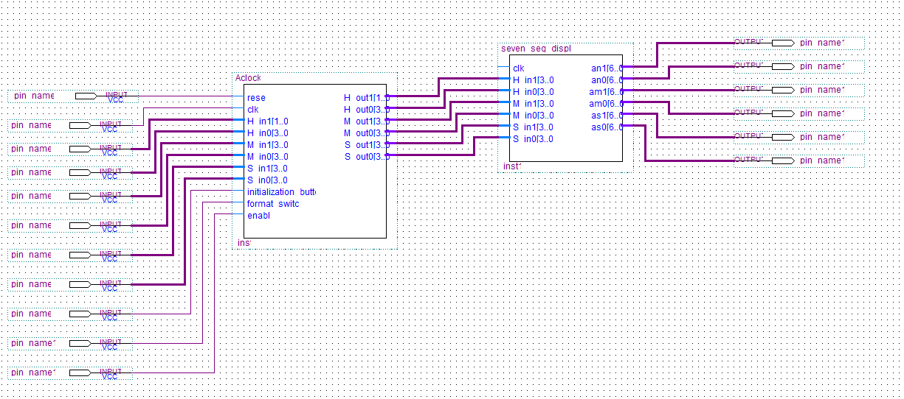
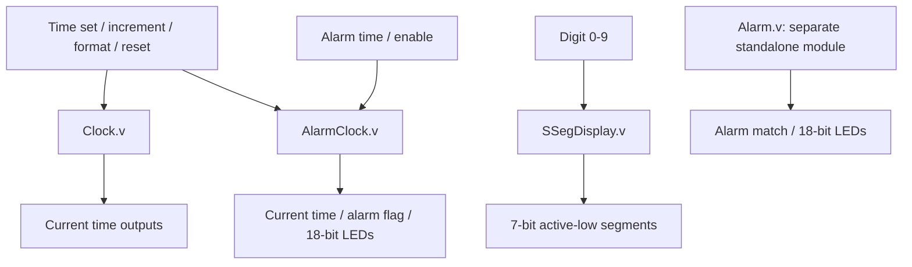
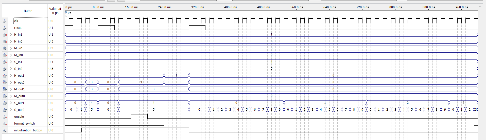
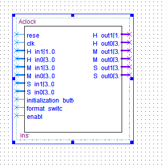
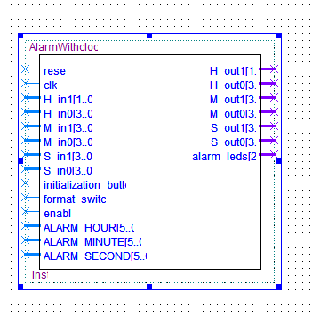
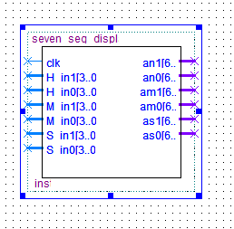
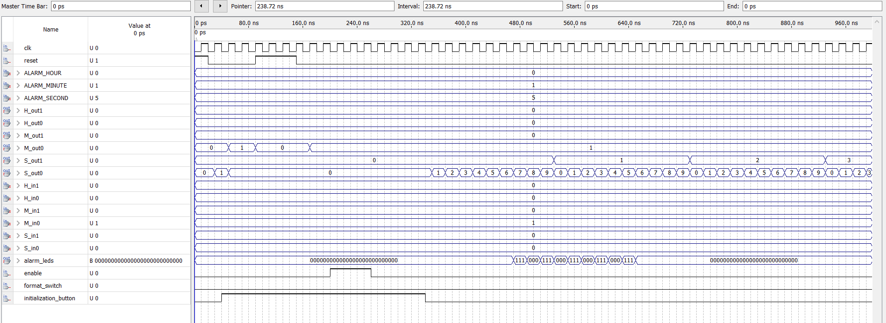
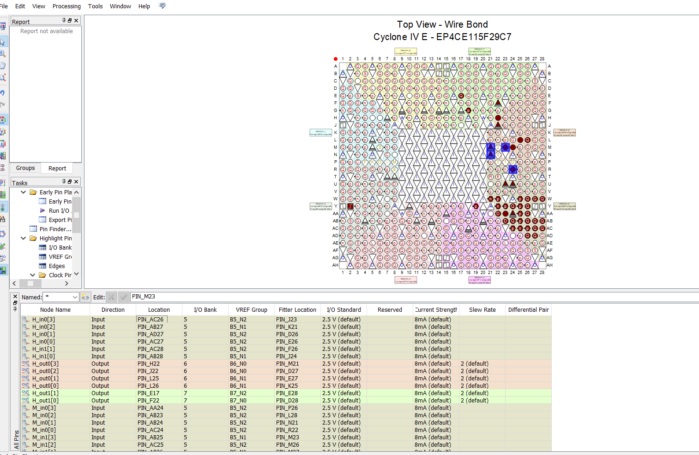

# FPGA Digital Alarm Clock

**Digital clock and alarm control in Verilog HDL, developed for an Altera Cyclone IV E / Terasic DE2-115 FPGA workflow.**

**Author:** [Waleed Alakwa](https://github.com/WaleedAlakwa)  
**Language:** Verilog HDL  
**Development tools shown:** Intel/Altera Quartus design tools and waveform simulator  
**Target board:** Terasic DE2-115 (Cyclone IV E device family)  
**License:** [MIT](LICENSE) — for materials the author owns or has permission to license

> **Project status:** This repository contains the six author-supplied Verilog files (four design modules and two testbenches) plus 13 original screenshots. The HDL logic is preserved; copyright/license comments were added. Simulation screenshots and pin-planning captures are supplied as development evidence, **not** independently reproduced verification. A full Quartus project, board-specific constraint file, FPGA configuration image, and proof of successful physical-board programming were not supplied. See [known limitations](docs/KNOWN_LIMITATIONS.md).

## Overview

This project explores an FPGA-oriented digital clock with time setting, hour/minute/second increment controls, selectable 12-/24-hour display modes, alarm comparison and LED indication, and a seven-segment digit decoder.

The provided code includes a standalone clock (`Clock.v`), a clock with integrated alarm logic (`AlarmClock.v`), an additional standalone alarm module (`Alarm.v`), and a seven-segment decoder (`SSegDisplay.v`). These are **separate HDL building blocks**; a source top-level connecting all blocks to the photographed schematic and DE2-115 pins is not included.



*Author-supplied Quartus schematic screenshot. It illustrates a system-level arrangement but cannot be rebuilt exactly from the uploaded HDL alone.*

## Features represented in the supplied RTL

- **Time registers:** hour, minute, and second values, with synchronous time-load and reset controls.
- **Manual increments:** increment inputs for the clock values; second rollover can propagate into minute/hour updates.
- **Display formats:** a 12-/24-hour selection input (with a documented conversion defect in the standalone `Clock.v`).
- **Alarm comparison:** programmable hour/minute/second alarm values in `AlarmClock.v`, with `alarm_active` and an 18-bit LED output.
- **Seven-segment decoding:** `SSegDisplay.v` maps decimal digits to active-low seven-segment patterns.
- **Simulation assets:** two original Verilog testbenches and captured Quartus waveform screenshots.
- **FPGA design evidence:** symbol diagrams, block-diagram screenshots, device pin planning, and programmer configuration.

**Important:** The original clock modules do **not** automatically advance seconds once per second. They advance through `increment_sec` (or equivalent manual increment inputs), and the source does not include a 50-MHz-to-1-Hz divider. Alarm behavior and actual board operation require additional integration/testing; do not interpret the feature list as proof of a complete autonomous wall clock.

## RTL architecture



This diagram documents the **modules as delivered**, not a synthesizable complete board-level top. `SSegDisplay.v` expects an individual 4-bit decimal digit, so a real top-level would also need to split the clock values into display digits and connect the associated output pins.

| File | Purpose |
|---|---|
| `rtl/Clock.v` | Clock time registers, set/reset, manual increments, and format handling |
| `rtl/AlarmClock.v` | Alternative clock implementation with integrated alarm comparison/LED handling |
| `rtl/Alarm.v` | Standalone alarm comparison/LED module; not instantiated by `AlarmClock.v` |
| `rtl/SSegDisplay.v` | Single-digit, seven-segment decoder |
| `sim/ClockTestBench.v` | Original waveform-oriented stimulus for `Clock.v` |
| `sim/AlarmClockTestBench.v` | Original waveform-oriented stimulus for `AlarmClock.v` |

More details: [Architecture and signals](docs/ARCHITECTURE.md).

## Simulation

Two source testbenches are included. To compile and run locally using **Icarus Verilog** (not bundled), from the repository root:

```bash
mkdir -p build

# Standalone clock testbench
iverilog -g2012 -s ClockTestBench -o build/clock_tb \
  rtl/Clock.v sim/ClockTestBench.v
vvp -n build/clock_tb

# Integrated alarm-clock testbench
iverilog -g2012 -s AlarmClockTestBench -o build/alarm_clock_tb \
  rtl/AlarmClock.v sim/AlarmClockTestBench.v
vvp -n build/alarm_clock_tb
```

The original benches use a 10 ns stimulus clock period for convenience even though source comments refer to a 1 Hz clock. They do not contain automated assertions. In particular, the alarm-clock testbench sets an alarm at 00:00:10 but does not assert `increment_sec`, so the RTL does **not** automatically reach that alarm time during the stimulus. Treat these as waveform inspection demonstrations rather than complete functional tests. Commands are provided for reproduction, **not** as a claim they were executed while preparing this repository.



See [Simulation guide](docs/SIMULATION.md) and [Verification matrix](docs/VERIFICATION.md).

## FPGA setup

The screenshots show Quartus targeting a **Cyclone IV E EP4CE115F29**-family device. The Pin Planner screenshot labels **EP4CE115F29C7**. The programmer screenshot indicates **No Hardware**, so a successful JTAG transfer or physical FPGA execution is not established by these images.

To start a new hardware project, select the exact device installed on your board, add the RTL sources, build and verify an appropriate board-level top module, create/review pin assignments for your *actual board*, and compile. For practical wall-clock operation, add a suitable clock-enable generator and input conditioning before deploying.

Read [Quartus setup](docs/QUARTUS_SETUP.md) and [Pin assignments](docs/PIN_ASSIGNMENTS.md) before trying to wire or program hardware.

## Visual evidence

| Screenshot | Description |
|---|---|
|  | Symbol of the standalone clock design |
|  | Clock/alarm integrated-module symbol |
|  | Seven-segment decoder symbol |
|  | Alarm-control simulation capture |
|  | Quartus pin-planning view |

The full annotated set of **13 screenshots** is indexed in [Screenshot gallery](docs/SCREENSHOTS.md).

## Repository layout

```text
FPGA-Digital-Alarm-Clock/
├── README.md
├── LICENSE
├── AUTHORS.md
├── CITATION.cff
├── THIRD_PARTY_NOTICES.md
├── .gitignore
├── rtl/
│   ├── Clock.v
│   ├── AlarmClock.v
│   ├── Alarm.v
│   └── SSegDisplay.v
├── sim/
│   ├── ClockTestBench.v
│   └── AlarmClockTestBench.v
├── docs/
│   ├── ARCHITECTURE.md
│   ├── SIMULATION.md
│   ├── QUARTUS_SETUP.md
│   ├── PIN_ASSIGNMENTS.md
│   ├── VERIFICATION.md
│   ├── KNOWN_LIMITATIONS.md
│   ├── SCREENSHOTS.md
│   ├── ORIGINAL_FILE_HASHES.md
└── assets/
    └── screenshots/                  # 13 supplied captures
```

## Limitations and next engineering steps

See [Known limitations](docs/KNOWN_LIMITATIONS.md). Highest-priority items are an automatic 1 Hz clock-enable mechanism, correction of the standalone clock's 12-hour rollover, robust display-digit extraction/top-level wiring, self-checking alarm tests, and verified constraints and programming on the actual board.

## Author, copyright, and citation

**Waleed Alakwa** — [GitHub: @WaleedAlakwa](https://github.com/WaleedAlakwa)  
**Copyright (c) 2026 Waleed Alakwa.**

Original software/documentation released under the [MIT License](LICENSE), subject to applicable third-party rights. Copies or substantial portions of the software must retain the copyright and license notice. See [AUTHORS.md](AUTHORS.md), [CITATION.cff](CITATION.cff) for scholarly citation, and [THIRD_PARTY_NOTICES.md](THIRD_PARTY_NOTICES.md).
