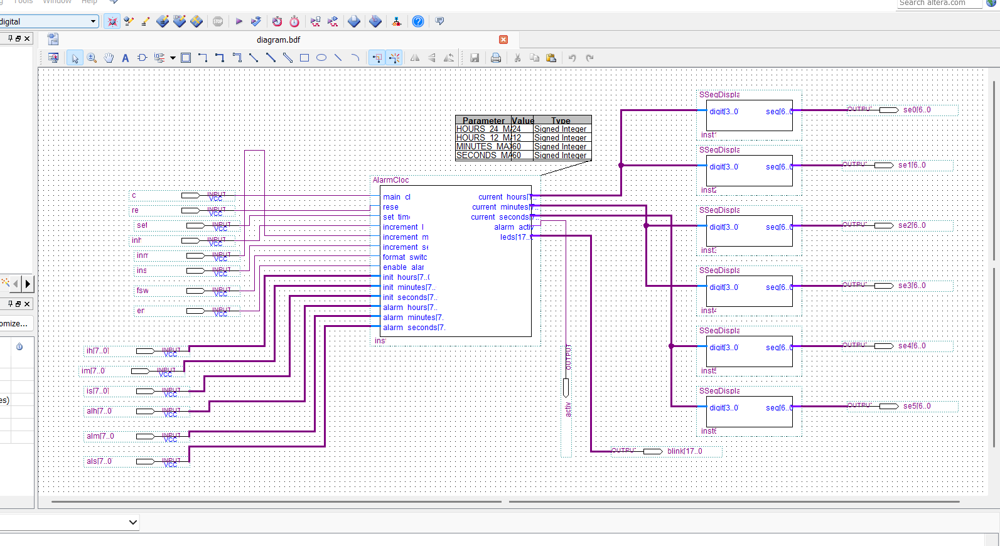
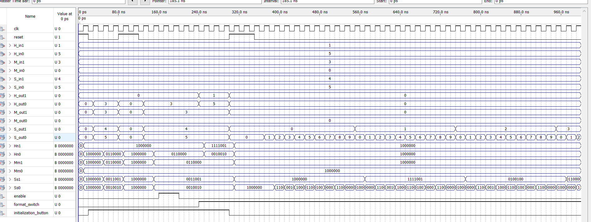
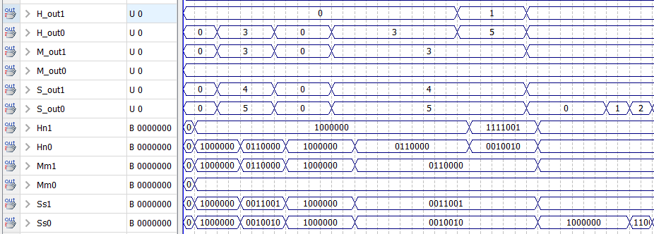
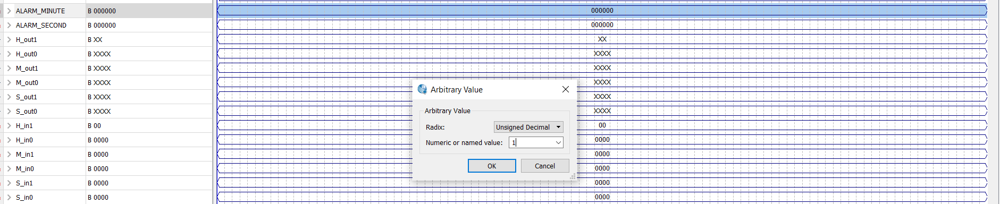
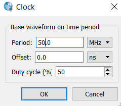
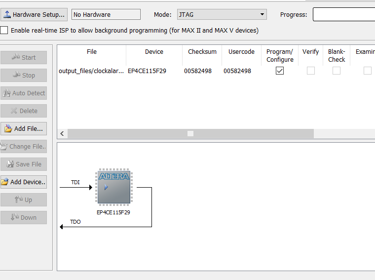

# Screenshot gallery

All images below were supplied with the project. They document design exploration and simulation in Quartus. Their presence does not prove the screenshots were regenerated from the exact delivered HDL revisions.

## Hardware-oriented design views

**Clock symbol**

**Integrated alarm-clock symbol**

**Seven-segment display symbol**

**Clock block connected to seven-segment display**

**Alternative alarm-clock schematic with six seven-segment decoder blocks**

## Simulation / test configuration

**Standalone clock waveform capture**

**Alarm-related waveform capture**

**Seven-segment waveforms, first capture**

**Seven-segment waveforms, second capture**

**Waveform detail, values and bit patterns**

**Clock stimulus configuration dialog (50 MHz shown)**

## FPGA device and programming configuration

**Pin Planner, Cyclone IV E**

**Programmer screenshot — displays No Hardware**

> **Naming note:** The uploaded file `set min.PNG` actually shows an *Arbitrary Value* dialogue in a waveform viewer. It has been retained as a waveform-detail image rather than described as proof of an interactive time-setting user interface.
